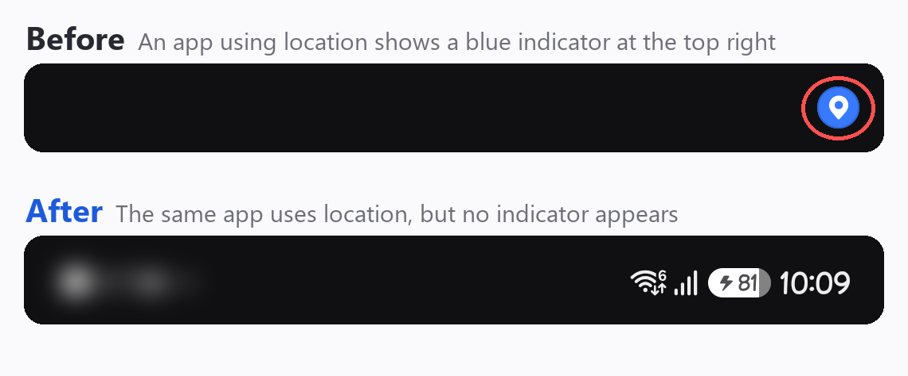
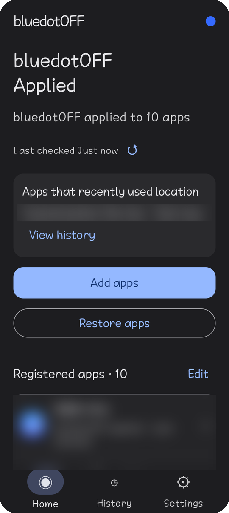
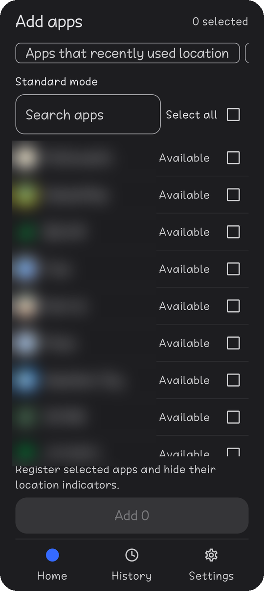
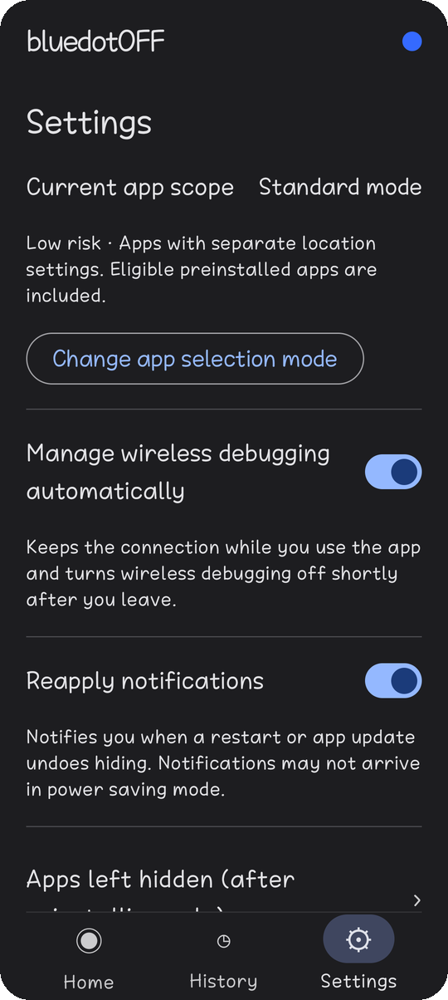

# bluedotOFF

[한국어](README.md) | **English**

**[⬇ Download the latest APK](https://github.com/mattewbel/bluedotOFF/releases/latest)** — get `bluedotOFF-1.0.3-release.apk` under Assets.

> 🔒 **Open source · No ads, analytics or external servers · No root**  
> The wireless debugging connection stays inside the phone (127.0.0.1). Location permissions are untouched; only one indicator flag (`0x100`) changes.  
> To confirm a download is the official file, see `checksums.txt` on the release. Signing certificate SHA-256: `61:9F:E1:EC:BD:F5:9D:5D:0B:83:8D:DC:64:20:E5:8B:E9:0F:82:8B:E1:1C:B6:1F:E6:C8:E6:AA:4C:EA:AD:62`

An app for Samsung One UI 9 (Android 17) phones that **hides the blue location indicator (Blue Dot) only for the apps you choose**.
Location permissions and location history stay as they are. bluedotOFF changes a single setting that controls the status bar indicator, and you can undo it at any time.

- No root, no bootloader unlock, no computer needed. It only uses the phone's built-in **Wireless debugging**.
- No server communication, no ads, no analytics, no tracking.

> **Note:** bluedotOFF is a personal project and is not affiliated with Samsung or Google. It uses Developer options and Wireless debugging; use it at your own risk. You can always restore the original state from the app, but **restore everything before uninstalling the app**.

## What it does

<p align="center"></p>

| Home | Add apps | Settings |
|:---:|:---:|:---:|
|  |  |  |
| Applied apps and apps to reapply at a glance | Pick apps to hide and apply at once | Scope, automatic management, reapply notifications, apps left hidden |

<sub>Screenshots from a real device (Galaxy Z Fold7). Installed app names and icons are blurred. The app shows English on any non-Korean phone.</sub>

1. Pair the app with your phone once through Wireless debugging (on the phone itself, no computer).
2. Choose the apps whose blue location dot you want to hide.
3. When those apps use location, the blue dot no longer appears. Location features and permissions keep working.

## Why

Starting with One UI 9, a blue dot appears in the status bar whenever an app uses location. That is good for privacy, but it also keeps showing for apps you **already trust**, such as weather or maps. Turning off their location permission breaks them.

bluedotOFF has one goal:

- **Turn off the dot only for apps you trust.** Location permissions, history and other apps are left alone.
- **Touch the phone as little as possible.** No root and no system file changes; one setting per app.
- **Always reversible.** The previous state is recorded first, and nothing is changed when the state cannot be confirmed.

## Limitations

- **Some apps lose hiding quickly.** When an app changes its own components, is updated, or the phone restarts, Android resets the indicator setting to its default. Some banking apps, for example, lose it within minutes. With automatic wireless debugging management, such apps are hidden again automatically when you open bluedotOFF (Settings → **Re-apply automatically when opened**, on by default). Nothing changes while the app is not open.
- **Only a few devices have been tested.** The developer verified the Galaxy Z Fold7, and a user confirmed the Galaxy Z Fold8 ([Tested devices](#tested-devices)). Other models work only if their internals are identical; otherwise the app stops without changing anything.
- **US models** have an extra location indicator path, so the dot may not be hidden.
- **It does not work while Auto Blocker is on.** Auto Blocker blocks wireless debugging. Turn it off in Settings → Security and privacy → Auto Blocker when you use the app. New Galaxy phones have it on by default, and with “Turn on automatically” it turns back on after 30 minutes. With automatic management, the app notices the block and tells you how to turn it off.
- **Developer options and Wireless debugging are required.** With automatic management, Wireless debugging stays on while you use the app (Android may show a "Wireless debugging connected" notification once when it opens) and turns off shortly after you leave.
- **Restore everything before uninstalling.** Tap Settings → **Restore before uninstalling**. If you just uninstall, the hidden apps may stay hidden. After reinstalling, you can unhide them in Settings → **Apps left hidden (after reinstalling only)**. However, shared app groups and some internal system apps cannot be unhidden there after their records are lost.


## Tested devices

| Device | Model | One UI | Region | Status |
|---|---|---|---|---|
| Galaxy Z Fold7 | SM-F966N | 9 | Korea | Verified by the developer |
| Galaxy Z Fold8 | SM-F971N | 9.0 | Korea (KOO) | User report — apply and restore work in KakaoMap and Naver Map |

If you tried another model, please share the result in [Issues](../../issues) using Settings → **Copy diagnostic info**. Working devices are added to this list too.

## Install

Download the latest APK (`bluedotOFF-1.0.3-release.apk`) from [Releases](../../releases) and install it. You may need to allow "Install unknown apps" the first time.

## Requirements

- A phone with Samsung One UI 9 or later and Android 17 or later
- Wi-Fi connection (needed for Wireless debugging; no data is sent over the internet)
- US models (CSC country code US) can use the app, but Home shows a warning. US models have one more way of showing the location indicator, so the blue dot may remain even after applying.
- On first connection, the app checks that the phone's internals match verified values. Verified on the Galaxy Z Fold7 and confirmed by a user on the Galaxy Z Fold8; other One UI 9 models can be used if they are identical. If not, the app stops as an unsupported device without changing anything.

## First-time setup

Tap **Get started** and the app guides you step by step. Completed steps are skipped automatically.

1. Choose whether to allow notifications (handy for entering the pairing code straight from the notification)
2. Turn on Developer options: About phone → Software information → tap **Build number** seven times
3. Connect to Wi-Fi
4. Allow the Nearby devices permission
5. Turn on Wireless debugging → tap **Pair device with pairing code**
6. Enter the 6-digit code with **Enter code** in the notification (without notifications, use split screen and type it into the app)
7. The app checks the device and the app list
8. Choose whether to use **Manage wireless debugging automatically** (recommended)
9. Choose the **scope** → go to Home

Pairing is needed only once.

## Using the app

- **Hide:** Home → **Add apps** → find apps with search and filters → **Add N**. You can also hide apps that recently used location from **History**. Tap an app in History to see its details, and tap ↻ to reload the history.
- **Restore:** Home → **Restore apps** → **Restore all**, or **Choose apps** (also Home → **Edit**) to pick apps with search and Select all like Add apps, then **Restore N**. You can also restore one app from its detail screen with **Unhide · restore original setting**.
- **Reapply:** After a restart or an app update, Android may turn the indicator back on. With automatic management, opening bluedotOFF re-applies those apps and shows "Re-applied automatically to N apps" (turn it off in Settings → **Re-apply automatically when opened**). After a phone update, or for apps that need checking or were reinstalled, it does not run automatically; tap **reapply needed** on Home.
- **Check again:** Tap ↻ next to **Last checked N min ago** on Home to recheck your registered apps right away.
- **Before uninstalling:** Settings → **Restore before uninstalling**. It returns every hidden app to its original state and then tells you whether you can uninstall bluedotOFF.
- **Keep the screen open while it works.** If you leave the app during apply or restore, the remaining apps are not changed. Apps already done stay as they are.
- **Apps left hidden (after reinstalling only):** Only needed if bluedotOFF was removed and installed again. Settings → **Apps left hidden (after reinstalling only)** → pick apps → **Unhide N**. Preinstalled apps may have had the indicator off originally, so Select all skips them; pick them one by one.

### Scope

| Scope | Risk | Included apps |
|---|---|---|
| Standard mode | Low | Regular apps that have their own location setting (including preinstalled apps that pass the checks) |
| All apps mode | Medium | Standard + app groups that share a location setting with other apps, system apps, apps without a home screen icon |

- Apps that share a setting with other apps are hidden and restored together as a group. Large groups (10 or more apps) and Android system groups (e.g. Find My Mobile) ask once more before they are selected. Groups in which no app uses location are not listed.
- Lowering the scope first restores the apps that fall outside the new scope, then changes the scope.
- Risk is a rough guide for understanding, not a failure rate.

### Manage wireless debugging automatically

When on, the app keeps Wireless debugging on only while you use it and turns it off shortly after you leave the app. For this, the app is given permission to change system settings once. The permission is used only to turn Wireless debugging on and off.
To stop, turn off **Settings → Manage wireless debugging automatically** or tap **Settings → Advanced settings → Remove automatic management permission**. Without automatic management, you can turn it off yourself with **Settings → Turn off wireless debugging** after you are done.

## Good to know

- **Before uninstalling, tap Settings → Restore before uninstalling.** It returns every app to its original state and then tells you whether it is safe to uninstall. Uninstalling or clearing app data also removes the record of the original state, so hidden apps stay hidden. After reinstalling, such apps show as "Hidden · no record" and can be unhidden in Settings → **Apps left hidden (after reinstalling only)**. Without a record this turns the indicator setting on rather than restoring an exact original, and apps the system excludes from the indicator may still not show it. However, shared app groups and some internal system apps cannot be unhidden there after their records are lost. Restarting the phone sometimes brings the indicator back, but it depends on the app.
- Android sometimes turns the indicator back on (restart, app update, OS policy). The app detects this and shows **reapply needed**.
- There is no real-time monitoring. **When you open the app again**, it rechecks only the apps Android reported as changed (update, install, component change), or all registered apps if 10 minutes have passed. Tap ↻ next to **Last checked** on Home to check at any time. While bluedotOFF is fully closed, reapply notifications cannot report app updates right away, and they may not arrive in power saving mode.
- If the connection drops or the state cannot be confirmed, the app does not report success and stops changing things. If you see **Restore needs review**, do not clear app data; connect again and recheck.
- **Reset this app's pairing** only clears this app's connection data. To remove the phone's record, go to Wireless debugging → Paired devices → bluedotOFF → Forget.
- Apps whose indicator was already off stay off after restoring (that is their exact original state). To turn the indicator on, unhide them in Settings → **Apps left hidden (after reinstalling only)**.

## Language

Korean phones show Korean; every other language (English, Spanish, Chinese, …) shows English.

## Questions and bug reports

Please open an issue in this repository's [Issues](../../issues). If the app stopped making changes (for example **Restore needs review**), do not clear app data; ask in Issues instead. Do not post personal information (phone numbers, accounts, location history screens, etc.). Tapping Settings → About & support → **Copy diagnostic info** and pasting the result helps a lot. It contains only device and version details, not your installed apps or location history.

## Privacy and security

- The network permission is used only for the on-phone Wireless debugging connection (127.0.0.1).
- Connection keys are encrypted with the phone's secure storage (AndroidKeyStore) and are not backed up.
- Pairing codes and keys are never written to logs or the clipboard.
- The only thing changed is one "user sensitive" display flag of the precise location permission (FINE permission flag `0x100`). The permission itself, usage history and other settings are not changed.

---

## For developers

Requires JDK 17, Android SDK 37, build-tools 36, NDK 27.2.12479018 and CMake 3.22.1.

```powershell
.\gradlew.bat :core:test :app:testLocalDebugUnitTest :app:testLocalReleaseUnitTest :app:assembleLocalDebug :app:assembleLocalRelease :app:lintLocalDebug :app:lintLocalRelease
```

- Output: `app/build/outputs/apk/local/debug/app-local-debug.apk`, `app/build/outputs/apk/local/release/app-local-release.apk`
- Release signing is read from `../.private/bluedotOFF-release.properties`, outside the source tree. Never share or commit that file or the key.
- Release builds are shrunk with R8. The helper is launched by name, so keep the rule in `app/proguard-rules.pro`.
- Scripts in `scripts/`, project rules for contributors in [AGENTS.md](AGENTS.md), and history in [docs/CHANGELOG.md](docs/CHANGELOG.md) (Korean).

### License

bluedotOFF is distributed under the [Apache License 2.0](LICENSE). Bundled third-party code: AndroidX/Kotlin (Apache 2.0), parts of AOSP ADB pairing (Apache 2.0), BoringSSL/fiat-crypto (permissive). Full third-party license texts are in `app/src/main/assets/licenses/`.
