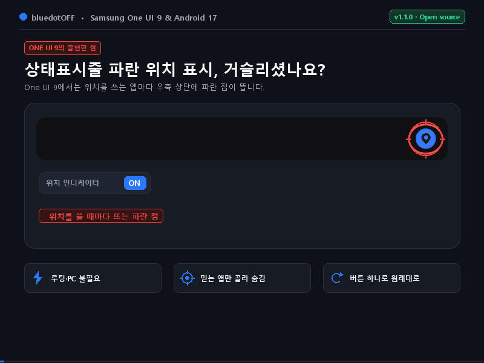
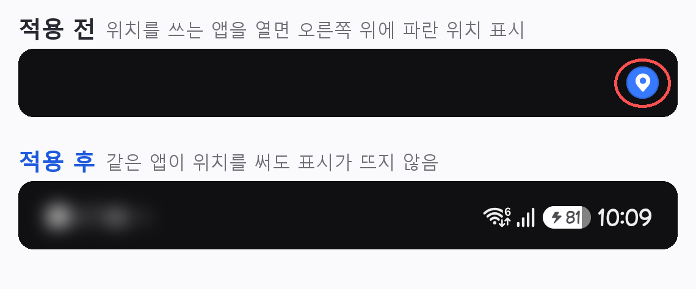
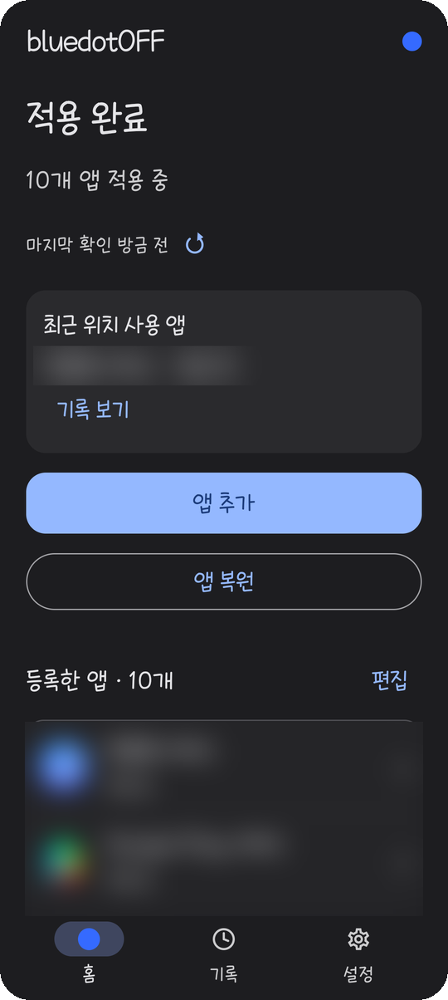
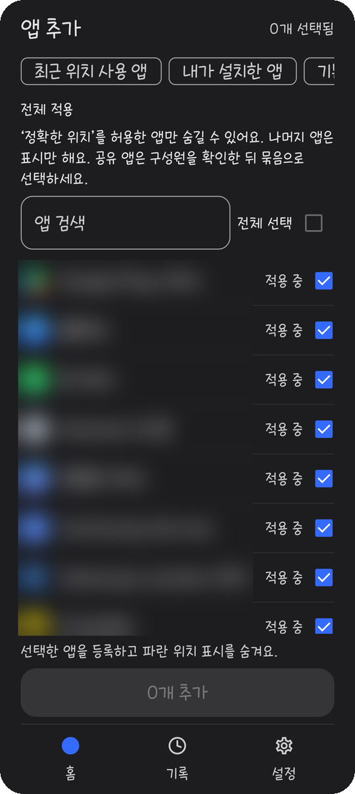
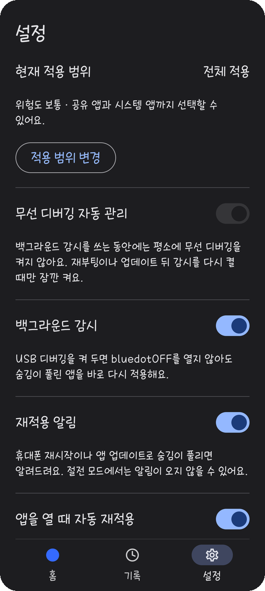

# bluedotOFF

[English](README.md) | **한국어**

**[⬇ 최신 APK 다운로드](https://github.com/mattewbel/bluedotOFF/releases/latest)** — Assets에서 `bluedotOFF-1.1.4-release.apk`를 받으세요.

> 🔒 **오픈소스 · 광고·분석·추적 없음 · 루팅 불필요**  
> 무선 디버깅 연결은 휴대폰 안(127.0.0.1)에서만 이뤄지고, 위치 권한은 그대로 둔 채 위치 표시 설정 한 칸(`0x100`)만 바꿉니다.  
> 받은 파일이 공식 파일인지 확인하려면 릴리스의 `checksums.txt`를 보세요. 서명 인증서 SHA-256: `61:9F:E1:EC:BD:F5:9D:5D:0B:83:8D:DC:64:20:E5:8B:E9:0F:82:8B:E1:1C:B6:1F:E6:C8:E6:AA:4C:EA:AD:62`

Samsung One UI 9 (Android 17) 휴대폰에서 **내가 고른 앱의 파란 위치 표시(Blue Dot)만 숨기는 앱**입니다.
앱의 위치 권한과 위치 사용 기록은 그대로 두고, 상태 표시줄에 보이는 표시 설정 하나만 바꿉니다. 바꾸기 전 상태를 기록해 두어 앱에서 원래 상태로 되돌릴 수 있습니다.

- 루팅, 부트로더 해제, 컴퓨터 연결이 필요 없습니다. 휴대폰의 **무선 디버깅** 기능만 사용합니다(백그라운드 감시를 켜면 USB 디버깅도).
- 광고, 분석, 추적 기능은 없습니다. 인터넷은 선택 기능인 [업데이트 확인](#업데이트-확인)을 켠 경우에만, GitHub에서 최신 버전을 확인할 때 씁니다(기본 꺼짐).

> **안내:** bluedotOFF는 Samsung·Google과 관계없는 개인 프로젝트입니다. 개발자 옵션과 무선 디버깅을 사용하며, 사용에 따른 결과는 사용자 책임입니다. 앱에서 원래 상태로 되돌릴 수 있지만, **앱을 지우기 전에는 먼저 모두 복원**해 주세요.

## 이런 앱이에요

<p align="center"></p>

<p align="center"></p>

| 홈 | 앱 추가 | 설정 |
|:---:|:---:|:---:|
|  |  |  |
| 적용 현황과 다시 적용할 앱을 한눈에 | 숨길 앱을 골라 한 번에 적용 | 적용 범위, 자동 관리, 백그라운드 감시, 재적용 알림, 숨김이 남은 앱 |

<sub>실제 기기(Galaxy Z Fold7) 화면입니다. 설치된 앱 이름과 아이콘은 흐리게 가렸습니다.</sub>

1. 무선 디버깅으로 휴대폰과 한 번 연결합니다 (컴퓨터 없이 휴대폰 안에서만).
2. 파란 위치 표시를 숨기고 싶은 앱을 고릅니다.
3. 그 앱이 위치를 써도 상단의 파란 점이 뜨지 않습니다. 위치 기능과 권한은 그대로 동작합니다.

## 왜 만들었나요

One UI 9부터 앱이 위치를 쓸 때마다 상태 표시줄에 파란 점이 나타납니다. 개인정보 보호에는 좋은 기능이지만, 날씨·지도처럼 **이미 믿고 쓰는 앱**에서도 계속 떠서 신경이 쓰입니다. 그렇다고 위치 권한을 끄면 앱 기능이 망가집니다.

bluedotOFF의 목표는 이 하나입니다.

- **믿는 앱의 파란 점만 끈다.** 위치 권한, 사용 기록, 다른 앱은 건드리지 않습니다.
- **휴대폰을 최소한으로만 건드린다.** 루팅·시스템 파일 수정 없이, 앱마다 설정 한 칸만 바꿉니다.
- **원래대로 되돌리기.** 바꾸기 전 상태를 기록해 두고, 확인되지 않는 상황에서는 아무것도 바꾸지 않습니다. 기록이나 앱 설치 정보가 확인되지 않으면 되돌리기도 멈추고 이유를 알려줍니다.

## 한계

- **일부 앱은 숨김이 금방 풀립니다.** 앱이 스스로 구성을 바꾸거나 업데이트되면, 그리고 휴대폰을 재시작하면 Android가 표시 설정을 기본값으로 되돌립니다. 예를 들어 어떤 금융 앱은 몇 분 만에 풀리기도 합니다. 무선 디버깅 자동 관리를 쓰면 풀린 앱은 bluedotOFF를 열 때 자동으로 다시 적용됩니다(설정 → **앱을 열 때 자동 재적용**, 기본 켜짐). [백그라운드 감시](#백그라운드-감시)가 실행 중이면 앱을 열지 않아도 감지하는 대로 다시 숨기고(휴대폰을 재시작한 뒤에는 앱을 한 번 열어 감시를 다시 시작해야 합니다), 끈 상태에서는 앱을 열지 않는 동안 아무것도 바꾸지 않습니다.
- **위치 권한을 ‘정확한 위치’로 허용한 앱만 숨길 수 있습니다.** ‘대략적인 위치’만 허용한 앱은 목록에 나오지 않거나(전체 적용에서는) 표시만 됩니다. 숨기려면 그 앱의 위치 권한을 ‘정확한 위치’로 바꿔 주세요.
- **테스트한 기기가 아직 적습니다.** 개발자가 Galaxy Z Fold7에서 직접 검증했고, Galaxy Z Fold8에서는 사용자가 정상 작동을 확인했습니다([테스트한 기기](#테스트한-기기)). 다른 기종은 내부 구조가 같을 때만 동작하고, 다르면 아무것도 바꾸지 않고 멈춥니다.
- **일부 금융 앱은 개발자 옵션이 켜져 있으면 실행되지 않을 수 있습니다.** 한국의 은행·증권·결제 앱 일부가 그렇습니다. bluedotOFF는 개발자 옵션이 필요하므로, 그런 앱을 쓸 때는 개발자 옵션을 잠시 꺼야 할 수 있습니다. 다시 켠 뒤 bluedotOFF를 열면 됩니다. 백그라운드 감시는 USB 디버깅도 켜 둬야 해서 이런 앱이 더 자주 막힐 수 있습니다. USB 디버깅이나 개발자 옵션을 껐다면, 다시 켤 때 개발자 옵션과 USB 디버깅을 켜고 Wi-Fi에서 bluedotOFF를 열면 감시가 다시 시작됩니다(페어링 코드는 다시 넣지 않아도 됩니다).
- **미국 판매 모델**은 위치 표시 방식이 하나 더 있어서 숨겨지지 않을 수 있습니다.
- **보안 위험 자동 차단이 켜져 있으면 쓸 수 없습니다.** 이 기능은 무선 디버깅을 막습니다. 작업할 때는 설정 → 보안 및 개인정보 보호 → 보안 위험 자동 차단을 꺼주세요. 새 갤럭시는 기본으로 켜져 있고, ‘자동으로 켜기’를 켜두면 30분 뒤 다시 켜집니다. 자동 관리를 쓰면 앱이 막힌 것을 알아채고 끄는 방법을 안내합니다. 이 기능은 USB 디버깅도 끄기 때문에 백그라운드 감시도 멈춥니다.
- **개발자 옵션과 무선 디버깅이 필요합니다.** 자동 관리를 쓰면 앱을 쓰는 동안 무선 디버깅이 켜져 있고(앱을 열 때 Android의 "무선 디버깅 연결됨" 알림이 한 번 뜰 수 있습니다), 앱을 나가면 잠시 후 꺼집니다.
- **앱을 지우기 전에 먼저 모두 복원해야 합니다.** 설정 → **앱 삭제 전 복원**을 누르면 됩니다. 그냥 지우면 숨긴 앱들이 숨김 상태로 남을 수 있습니다. 이렇게 남은 앱은 다시 설치한 뒤 설정 → **숨김이 남은 앱 (재설치 시에만)**에서 숨김을 풀 수 있습니다. 단, 여러 앱이 설정을 공유하는 묶음이나 일부 내부 시스템 앱은 기록을 지운 뒤 이 메뉴에서 숨김을 풀 수 없습니다.


## 테스트한 기기

| 기기 | 모델 | One UI | 국가 | 확인 |
|---|---|---|---|---|
| Galaxy Z Fold7 | SM-F966N | 9 | 한국 | 개발자 직접 검증 |
| Galaxy Z Fold8 | SM-F971N | 9.0 | 한국 (KOO) | 사용자 확인 — 카카오맵·네이버지도 적용·복원 정상 |

다른 기종에서 써 보셨다면 설정 → 정보 및 지원 → **진단 정보 복사 및 보내기**로 메일을 보내거나 [Issues](../../issues)에 알려주세요. 잘 되는 기기도 목록에 추가합니다.

## 설치

[Releases](../../releases)에서 최신 APK(`bluedotOFF-1.1.4-release.apk`)를 받아 설치합니다. 처음 설치할 때 "출처를 알 수 없는 앱 설치" 허용이 필요할 수 있습니다.

## 필요한 것

- Samsung One UI 9 이상, Android 17 이상 휴대폰
- Wi-Fi 연결 (무선 디버깅에 필요합니다. 인터넷으로 데이터를 보내지 않습니다. 백그라운드 감시를 쓰면 감시를 시작할 때만 필요합니다.) 인터넷을 쓰는 것은 선택 기능인 [업데이트 확인](#업데이트-확인)뿐입니다.
- 숨길 앱은 위치 권한이 ‘정확한 위치’로 허용돼 있어야 합니다.
- 미국 판매 모델(CSC 국가 코드 US)에서도 쓸 수 있지만, 홈에 안내가 표시됩니다(**확인했어요**를 누르면 다시 표시되지 않습니다). 미국 모델은 위치 표시를 띄우는 방식이 하나 더 있어서 적용해도 파란 점이 사라지지 않을 수 있습니다.
- 앱은 처음 연결할 때 휴대폰 내부 구조가 검증된 값과 같은지 확인합니다. Galaxy Z Fold7에서 검증했고 Galaxy Z Fold8에서도 사용자가 확인했으며, 다른 One UI 9 기종도 구조가 같으면 사용할 수 있습니다. 다르면 아무것도 바꾸지 않고 "지원하지 않는 기기"로 멈춥니다.

## 처음 설정하기

**시작하기**를 누르면 앱이 한 단계씩 안내합니다. 완료된 단계는 자동으로 건너뜁니다.

1. **시작하기**
2. 알림 허용 여부 선택 (페어링 코드를 알림에서 바로 입력할 수 있어 편합니다)
3. 개발자 옵션 켜기 — 휴대폰 정보 → 소프트웨어 정보 → **빌드번호**를 7번 누르기
4. Wi-Fi 연결
5. 근처 기기 권한 허용
6. 무선 디버깅 켜기 → **페어링 코드로 기기 페어링** 누르기
7. 알림의 **코드 입력**에 6자리 코드 입력 (알림을 쓰지 않으면 분할 화면으로 앱에 직접 입력)
8. 기기와 앱 확인
9. **연결 유지 방법** 선택: **① 앱을 켤 때만 적용**(무선 디버깅 자동 관리) 또는 **② 백그라운드 자동 감시**(USB 디버깅). USB를 고르면 5초 위험 안내 뒤 USB 디버깅이 꺼져 있으면 개발자 옵션으로 안내합니다. **지금은 사용하지 않기**도 고를 수 있습니다.

이후 순서는 선택한 연결 방식에 따라 달라집니다.

- **USB 감시:** 10단계 **배터리 사용 제한 해제**(선택 사항, **나중에**로 건너뛰기 가능) → 11단계 적용 범위 → 12단계 최종 기기 확인 → 홈.
- **무선 방식 또는 지금은 사용하지 않기:** 10단계 적용 범위 → 11단계 최종 기기 확인 → 홈.

배터리 설정은 Android 확인 창에 동의해야 바뀝니다. 검증된 Fold7에서는 버튼이 **확인 / 취소**로 표시됩니다. 취소했다면 앱의 **나중에**로 계속할 수 있습니다. 확인 창을 열 수 없거나 이미 허용된 경우에는 앱 정보 → 배터리 → **제한 없음**으로 안내합니다.

페어링은 처음 한 번만 하면 됩니다.

## 사용하기

- **기록 새로고침:** 기록 목록을 아래로 당기거나 ↻ 버튼을 누르세요. **재적용 기록** 탭에는 앱이 다시 적용한 결과와 시간이 최신순으로 나와요. 백그라운드 감시·앱을 열 때·직접 재적용을 구분하고 최근200건을 보관해요. 이 탭은 Wi-Fi나 디버깅 연결 없이도 볼 수 있어요.
- **숨기기:** 홈의 **앱 추가** → 검색·필터로 앱 선택 → **N개 추가**. 숨김 상태 확인이 끝난 앱은 상세 화면의 **적용 중** 버튼이 비활성화됩니다. 또는 **기록**에서 최근 위치를 쓴 앱을 골라 숨길 수 있습니다. 기록의 앱을 누르면 상세 정보를 볼 수 있고, ↻ 버튼으로 기록을 새로 읽습니다.
- **되돌리기:** 홈의 **앱 복원** → **모두 복원**, 또는 **골라서 복원**(홈의 **편집**도 같은 화면)에서 앱 추가처럼 검색·전체 선택으로 고른 뒤 **N개 복원**. 앱 상세의 **숨김 해제 · 원래 상태로 복원**으로 하나씩 되돌릴 수도 있습니다.
- **다시 적용:** 휴대폰을 재시작하거나 앱이 업데이트되면 Android가 표시를 다시 켤 수 있습니다. 앱 업데이트 등으로 풀린 경우, [백그라운드 감시](#백그라운드-감시)가 실행 중이면 앱을 열지 않아도 감지하는 대로 다시 적용합니다. 휴대폰을 재시작하면 감시도 멈추므로 앱을 한 번 열어야 합니다. 무선 디버깅 자동 관리를 쓰면 bluedotOFF를 열 때 이런 앱을 자동으로 다시 적용하고 "N개 앱 자동 재적용 완료"라고 알려줍니다(설정 → **앱을 열 때 자동 재적용**에서 끌 수 있음). 휴대폰 업데이트 후, 확인이 필요한 앱, 다시 설치된 앱은 자동으로 하지 않으니 홈의 **재적용 필요**를 눌러 직접 적용하세요.
- **다시 확인:** 홈의 **마지막 확인 N분 전** 옆 ↻ 버튼을 누르면 등록한 앱의 상태를 바로 다시 확인합니다.
- **앱을 지우기 전:** 설정 → **앱 삭제 전 복원**. 숨긴 앱을 모두 원래 상태로 되돌리고, 끝나면 bluedotOFF를 지워도 되는지 알려줍니다.
- **작업 중에는 화면을 열어 두세요.** 적용·복원 도중 앱을 나가면 남은 앱은 바꾸지 않고 멈춥니다. 이미 끝난 앱은 그대로 유지됩니다.
- **숨김이 남은 앱 (재설치 시에만):** bluedotOFF를 지웠다가 다시 설치했을 때만 필요합니다. 설정 → **숨김이 남은 앱 (재설치 시에만)** → 앱 선택 → **N개 숨김 풀기**. 기본 앱은 원래부터 표시가 꺼져 있었을 수 있어서 "전체 선택"에 들어가지 않고 하나씩 골라야 합니다.

### 적용 범위

| 범위 | 포함되는 앱 |
|---|---|
| 일반 적용 | 위치 설정을 혼자 쓰는 일반 앱 (조건을 통과한 기본 설치 앱 포함) |
| 전체 적용 | 일반 적용 + 다른 앱과 위치 설정을 함께 쓰는 앱 묶음, 시스템 앱, 홈 아이콘이 없는 앱 |

- 다른 앱과 묶인 앱은 묶음 전체를 함께 숨기고 함께 되돌립니다. 10개 이상이 묶인 큰 묶음이나 Android 시스템 묶음(예: 디바이스 찾기)은 선택하기 전에 한 번 더 확인합니다. 위치를 쓰는 앱이 없는 묶음은 목록에 나오지 않습니다.
- 범위를 낮추면, 새 범위에서 빠지는 앱을 먼저 원래 상태로 되돌린 뒤에 범위가 바뀝니다.

### 무선 디버깅 자동 관리

켜 두면 앱을 쓰는 동안만 무선 디버깅을 켜 두고, 앱을 나가면 잠시 후 끕니다(그 전에 앱이 강제로 종료되면 다음에 앱을 열 때 끕니다). 이를 위해 최초 한 번 이 앱에 시스템 설정 변경 권한을 줍니다. 이 권한은 무선 디버깅 켜기/끄기에만 씁니다.
끄고 싶으면 **설정 → 무선 디버깅 자동 관리**를 끄거나 **설정 → 고급 설정 → 자동 관리 권한 제거**를 누르세요. 자동 관리를 쓰지 않으면 작업 후 **설정 → 무선 디버깅 끄기**로 직접 끌 수 있습니다.
백그라운드 감시를 켜면 이 스위치는 잠기고, 재부팅이나 업데이트 뒤 감시를 다시 시작할 때만 무선 디버깅을 잠깐 켭니다.

### 백그라운드 감시

설정의 세 번째 항목입니다(기본 꺼짐). 처음 켤 때 5초 위험 안내를 읽고 확인합니다. 처음 설정 9단계에서 **② 백그라운드 자동 감시**를 골라도 켜집니다. 모든 사용자에게 설정 → **배터리 사용 제한 해제** 스위치가 제공됩니다. 끄면 앱 정보 화면이 열리며, 배터리에서 **최적화**를 선택해 직접 해제합니다. 스위치는 실제 설정을 다시 읽은 뒤 바뀝니다. 켜면 Android의 시스템 확인 창이 열리고, 여기서 **허용** 여부를 선택합니다. 삼성 휴대폰에서는 허용하면 배터리 설정이 **제한 없음**으로 적용됩니다. 확인 창을 열 수 없거나 이미 허용된 경우에는 설정에서 앱 정보 → 배터리 → **제한 없음**을 선택할 수 있습니다. 이는 백그라운드 감시가 앱을 닫은 뒤에도 동작하는 데 도움이 될 수 있지만, 배터리 사용량이 늘 수 있고 Android가 프로세스를 종료하지 않는다고 보장하지는 않습니다. 언제든 설정에서 바꿀 수 있습니다. 처음 설정에서는 백그라운드 자동 감시를 고른 경우에만 범위 선택 전에 이 제안이 나오며, **나중에**를 선택할 수 있습니다.

- **하는 일:** USB 디버깅이 켜져 있으면 bluedotOFF를 열지 않아도, 숨김이 풀린 앱(앱이 스스로 설정을 바꾸거나 업데이트된 경우)을 감지하는 대로 다시 숨깁니다. 보통 몇 초 안에 끝나지만, 절전 상태 등에서는 늦어질 수 있습니다. 이때 Wi-Fi와 무선 디버깅은 꺼져 있어도 됩니다.
- **필요한 것:** USB 디버깅을 계속 켜 둬야 합니다. 앱이 USB 디버깅을 대신 켜지는 않고, 개발자 옵션 화면으로 안내합니다.
- **시작과 재시작:** 감시를 시작할 때는 Wi-Fi와 무선 디버깅이 잠깐 필요합니다. 휴대폰을 재시작하거나, bluedotOFF를 업데이트하거나, USB 디버깅을 끄면 감시가 멈추고 알림으로 알려줍니다. USB 디버깅을 다시 켜고 Wi-Fi에 연결된 상태에서 앱을 열면 다시 시작합니다(무선 디버깅 자동 관리가 켜져 있으면 자동으로, 아니면 무선 디버깅을 직접 켠 뒤). 감시가 멈춰 있는 동안에는 홈에 안내가 나오고, USB 디버깅이 다시 켜지면 알림으로 알려줍니다.
- **자동 관리와의 관계:** 감시를 쓰는 동안에는 평소에 무선 디버깅을 켜지 않습니다. **무선 디버깅 자동 관리** 스위치는 잠기고, 감시를 다시 시작할 때만 씁니다.
- **대상:** 등록되어 적용 중인 앱만 다시 숨깁니다. 복원했거나 등록을 해제한 앱, 다시 설치된 앱, 확인이 필요한 앱은 건드리지 않습니다. 묶음 앱은 묶음 전체가 등록돼 있을 때만 함께 처리합니다.
- **주의:** 일부 은행·결제 앱은 USB 디버깅이 켜져 있으면 실행되지 않을 수 있습니다. 보안 위험 자동 차단이 켜지면 USB 디버깅도 꺼져서 감시가 멈춥니다. 배터리 사용이 조금 늘 수 있습니다.
- **끄기:** 설정에서 스위치를 끄면 새 작업을 바로 막고, 진행 중인 안전 확인을 마친 뒤 감시를 끝냅니다. **앱 삭제 전 복원**은 감시가 켜져 있으면 감시 연결로 먼저 복원하고(Wi-Fi 불필요) 끝나면 감시를 끕니다.
- **안전:** 외부 포트, 루팅, 임의 명령 실행 기능은 없습니다. 감시용 도우미(helper)는 이 앱(서명 확인)의 정해진 요청만 받고, 원래 상태 저장·쓰기 직전 재확인·0/0.5/1.5초 확인·실패 시 되돌리기를 그대로 씁니다. 절전 상태에서 항상 즉시 다시 숨긴다고 보장하지는 않습니다.

### 업데이트 확인

기본은 꺼짐입니다. 앱이 한 번 물어보며(**켜기** 또는 **끄기**), 나중에 설정 → **업데이트 확인**에서 언제든 바꿀 수 있습니다.

- **켜면:** 하루에 한 번까지만 GitHub에 bluedotOFF 최신 출시 버전 번호를 물어봅니다. 미리보기(pre-release) 버전은 무시합니다. 계정·기기·앱 정보는 보내지 않습니다(휴대폰 모델명도 보내지 않습니다). 일반 웹 요청처럼 GitHub는 IP 주소를 볼 수 있습니다.
- **새 버전이 나오면:** 백그라운드 감시를 쓰면 시스템 알림 한 번, 그렇지 않으면 다음에 앱을 열 때 홈에 안내 카드가 나옵니다. 버전마다 한 번만 알려주고, **이 버전 건너뛰기**를 누르면 그 버전은 다시 알리지 않습니다. 앱이 직접 내려받거나 설치하지 않습니다. 누르면 GitHub 출시 페이지가 열리고, 새 APK는 직접 설치합니다.
- 설정의 **업데이트 확인** 옆 ↻ 버튼을 누르면 바로 확인하고 현재 버전과 최신 버전을 보여줍니다.
- **인터넷이 없거나 실패하면:** 아무것도 표시하지 않고 다음에 다시 확인합니다.

## 알아두세요

- **앱을 지우기 전에 설정 → 앱 삭제 전 복원을 누르세요.** 모든 앱을 원래 상태로 되돌린 뒤, 지워도 되는지 알려줍니다. 앱 삭제나 데이터 초기화를 하면 원래 상태 기록도 함께 지워져서, 숨긴 앱이 숨겨진 채로 남습니다. 다시 설치하면 이런 앱은 "숨김 남음 · 기록 없음"으로 보이고, 설정 → **숨김이 남은 앱 (재설치 시에만)**에서 숨김을 풀 수 있습니다. 기록이 없으니 정확한 원래 상태로 되돌리는 것이 아니라 위치 표시 설정을 켜는 것이며, 시스템에서 표시를 제외하는 앱은 숨김을 풀어도 표시가 나타나지 않을 수 있습니다. 단, 여러 앱이 설정을 공유하는 묶음이나 일부 내부 시스템 앱은 기록을 지운 뒤 이 메뉴에서 숨김을 풀 수 없습니다. 휴대폰을 재시작하면 표시가 돌아오기도 하지만 앱마다 다릅니다.
- Android가 표시를 다시 켜는 경우가 있습니다(재시작, 앱 업데이트, OS 정책). 앱은 이를 감지해 **재적용 필요**로 알려줍니다.
- 백그라운드 감시를 끈 상태에서는 실시간으로 감시하지 않습니다. **앱을 다시 열면** Android가 바뀌었다고 알려준 앱(업데이트·설치·구성 변경)만 다시 확인하고, 10분이 지났으면 등록한 앱 전체를 확인합니다. 홈의 ↻ 버튼으로 언제든 직접 확인할 수 있습니다. bluedotOFF가 완전히 종료돼 있는 동안 업데이트된 앱은 재적용 알림이 바로 오지 않고, 절전 모드에서도 알림이 오지 않을 수 있습니다.
- 연결이 끊기거나 상태를 확인할 수 없으면 성공으로 표시하지 않고 변경을 멈춥니다. **복원 확인 필요** 상태는 앱이 안전하게 확인할 수 없는 변경을 멈춘 경우입니다. 앱 데이터를 지우지 말고, 기기를 연결해 다시 확인하세요.
- **페어링 초기화**는 이 앱의 연결 정보만 지웁니다. 휴대폰 쪽 기록은 무선 디버깅 → 페어링된 기기 → bluedotOFF → 삭제로 직접 지우세요.
- 원래부터 표시가 꺼져 있던 앱은 복원해도 꺼진 상태 그대로입니다(정확한 원래 상태이기 때문입니다). 표시를 켜고 싶으면 설정 → **숨김이 남은 앱 (재설치 시에만)**에서 숨김을 풀 수 있습니다.

## 언어

영어, 한국어, 스페인어, 포르투갈어(브라질), 힌디어, 중국어 번체, 중국어 간체를 지원합니다. 휴대폰 언어를 따르고, 그 밖의 언어는 영어로 표시합니다. bluedotOFF만 다른 언어로 쓰려면 앱의 설정 → **언어**(또는 휴대폰 설정 → 애플리케이션 → bluedotOFF → 언어)에서 고르세요.

영어·한국어 외의 번역은 새로 추가됐습니다. 어색한 문장이 있으면 알려주세요([문의와 버그 신고](#문의와-버그-신고)). 번역이 있다고 모든 지역 모델에서 동작하는 것은 아닙니다. 중국 본토 판매 모델은 테스트하지 않았고, 확인되지 않은 기기에서는 아무것도 바꾸지 않고 멈춥니다.

## 문의와 버그 신고

이 저장소의 [Issues](../../issues)에 남겨 주세요. **복원 확인 필요** 상태처럼 앱이 변경을 멈춘 경우에도 앱 데이터를 지우지 말고 Issues에 문의해 주세요. 개인정보(전화번호, 계정, 위치 기록 화면 등)는 올리지 마세요. 문의할 때 설정 → 정보 및 지원 → **진단 정보 복사 및 보내기**를 누르면 메일 앱이 열려요. 그 내용을 보내거나 Issues에 붙여넣어 주시면 빨리 확인할 수 있어요. 기종·버전 정보만 들어가고, 설치된 앱 목록이나 위치 기록은 들어가지 않습니다.

## 개인정보와 보안

- 네트워크 권한은 휴대폰 안의 무선 디버깅 연결(127.0.0.1), 그 연결 포트를 찾는 Android 로컬 서비스 검색(NSD), 그리고 선택 기능인 [업데이트 확인](#업데이트-확인)에만 씁니다. **업데이트 확인을 끄면 bluedotOFF는 인터넷을 전혀 쓰지 않습니다.** 이 밖에 휴대폰 밖으로 나가는 것은 사용자가 메일 앱에서 직접 보내는 진단 정보뿐입니다.
- 백그라운드 감시용 도우미는 외부 포트를 열지 않고, 이 앱(서명 확인)의 정해진 요청만 받습니다.
- 연결 키는 휴대폰 보안 저장소(AndroidKeyStore)로 암호화해 보관하며 백업되지 않습니다.
- 페어링 코드와 키는 로그나 클립보드에 남기지 않습니다.
- 대상 앱에서 변경하는 것은 정확한 위치 권한의 "표시 민감도" 설정 하나(FINE 권한 플래그 `0x100`)뿐입니다. 위치 권한 자체와 사용 기록은 바꾸지 않습니다. 이 밖에 바꾸는 것은 [무선 디버깅 자동 관리](#무선-디버깅-자동-관리)를 켰을 때의 무선 디버깅 켜기/끄기와 그에 필요한 bluedotOFF 자신의 권한뿐입니다. bluedotOFF의 배터리 사용 제한 해제는 선택 사항이며, Android 확인 창에서 직접 승인할 때만 바뀝니다.

---

## 개발자용

### 빌드와 테스트

JDK 17, Android SDK 37, build-tools 36, NDK 27.2.12479018, CMake 3.22.1이 필요합니다.

```powershell
.\gradlew.bat :core:test :app:testLocalDebugUnitTest :app:testLocalReleaseUnitTest :app:assembleLocalDebug :app:assembleLocalRelease :app:lintLocalDebug :app:lintLocalRelease
```

- 출력: `app/build/outputs/apk/local/debug/app-local-debug.apk`, `app/build/outputs/apk/local/release/app-local-release.apk`
- Release 서명 설정은 소스 밖 `../.private/bluedotOFF-release.properties`에서 읽습니다. 이 파일과 키는 절대 공유·커밋하지 마세요.
- 디버그 APK는 기존 테스트 빌드와 같은 인증서라 기록을 유지한 채 업데이트 설치됩니다. 디버그 ↔ 릴리스 사이 전환 설치는 하지 않습니다.

### 스크립트 (`scripts/`)

| 파일 | 용도 |
|---|---|
| `finalize.py` | 위 Gradle 명령 후 실행. APK 서명·권한·정렬·테스트 결과를 검사하고 `artifacts/`에 APK와 감사 기록을 만듭니다. |
| `package_source.py` | 서명 비밀 정보를 뺀 소스 ZIP과 파일 해시 목록을 만듭니다. |
| `check_source_delivery.py` | 소스 ZIP에 서명 키·암호가 들어가지 않았는지 검사합니다. |
| `export_guide_svg.py` | `assets/guide/steps.json`으로 [설치 가이드 그림](docs/guide/README.md)을 다시 만듭니다. |
| `preview_sheet.py` | UI 테스트 스크린샷을 한 장으로 모읍니다 (Pillow 필요). |
| `prepare_signing.py` | Release 서명 키를 처음 한 번 만듭니다. 기존 키는 덮어쓰지 않습니다. |

### 문서

- [docs/CHANGELOG.md](docs/CHANGELOG.md) — 버전별 변경과 검증 기록
- `docs/Phase-*.md`, `docs/test.*-report.md` — 단계별 실기기 검증 보고서
- [docs/Indicator-Eligibility-Research.md](docs/Indicator-Eligibility-Research.md) — 표시 대상 판정 조사

### 릴리스 빌드

- Release 빌드는 R8로 코드를 줄입니다(약 20MB → 4MB). 도우미는 이름으로 실행되므로 `app/proguard-rules.pro`의 keep 규칙을 지우지 마세요.
- 오류 보고의 줄 번호를 읽으려면 각 릴리스의 `app/build/outputs/mapping/localRelease/mapping.txt`를 함께 보관하세요.
- Release 서명 키(`../.private/`)는 반드시 따로 백업하세요. 잃어버리면 기존 사용자에게 업데이트를 배포할 수 없습니다.
- GitHub에는 Release APK만 올립니다. Debug APK는 배포하지 않습니다.

### 라이선스

bluedotOFF는 [Apache License 2.0](LICENSE)으로 배포합니다. 포함된 서드파티 코드: AndroidX/Kotlin(Apache 2.0), AOSP ADB 페어링 일부(Apache 2.0), BoringSSL/fiat-crypto(permissive). 서드파티 라이선스 전문은 `app/src/main/assets/licenses/`에 있습니다.
