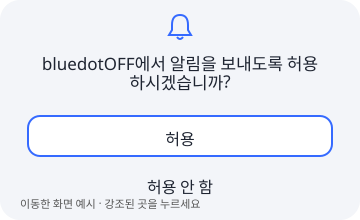
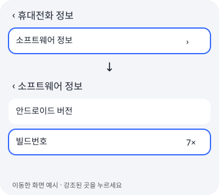
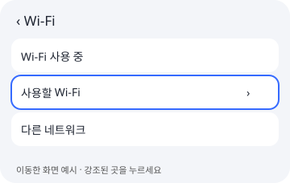
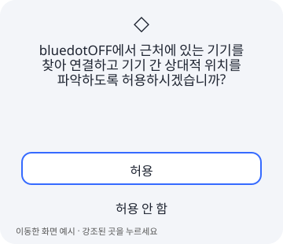
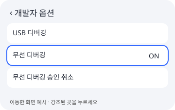
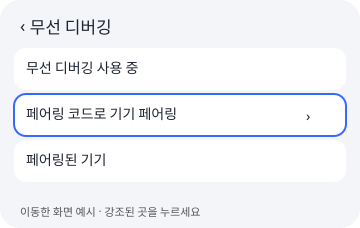
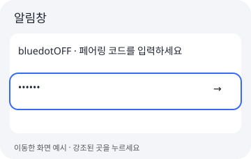
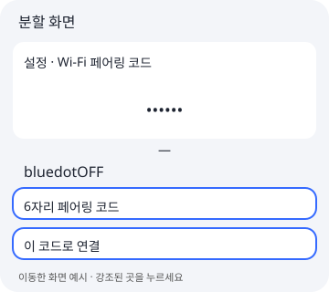

# 연결 준비 그림 가이드

무선 연결을 예로 든 그림 안내입니다. 최신 순서(백그라운드 감시를 고르면 배터리 단계가 더해지는 12단계, Wi-Fi가 없을 때의 PC로 시작)는 [README의 처음 설정하기](../../README.ko.md#처음-설정하기)를 따르세요. 이미 준비된 단계는 자동으로 생략합니다. 상단은 현재 순서까지만 표시하며 진행바를 누르면 각 단계의 실제 준비 상태를 확인할 수 있습니다. 그림은 이동한 화면에서 누를 곳을 강조한 개인정보 없는 예시입니다. 화면 문구와 배치는 OS 버전에 따라 다를 수 있습니다.

## 1. 시작하기

신뢰하는 앱의 파란 위치 표시를 숨깁니다.

## 2. 알림 허용

알림을 허용하면 설정 화면에서 바로 페어링 코드를 입력할 수 있어요.

## 3. 개발자 옵션 켜기

휴대전화 정보 → 소프트웨어 정보에서 빌드번호를 7번 누르세요.

## 4. Wi-Fi에 연결해주세요

Wi-Fi를 켜고 네트워크에 연결하면 다음 단계로 넘어가요.

## 5. 근처 기기 권한

권한 창에서 허용을 누르면 무선 디버깅 안내로 넘어가요.

## 6. 무선 디버깅 켜기

무선 디버깅을 켠 뒤 바로 페어링 코드 화면을 열어도 돼요.

## 7. 페어링 코드 화면 열기

페어링 코드로 기기 페어링을 누르고 코드 화면을 열어두세요.

설정의 코드 창을 열어둔 채 알림에서 코드를 입력하고 전송합니다. 알림 없이 연결하려면 설정과 앱을 분할 화면으로 함께 열어 입력합니다.

## 8. 기기와 앱 확인

연결과 기기 호환성, 앱의 복원 기록을 먼저 확인해요.

## 9. 연결 유지 방법 선택

① 앱을 켤 때만 적용(무선 디버깅 자동 관리), ② 백그라운드 자동 감시(USB 디버깅), 지금은 사용하지 않기 중에서 골라요. ①은 사용할 때 연결하고 작업이 끝나면 무선 디버깅을 꺼요.

## 10. 적용 범위 선택

일반 적용 또는 전체 적용을 선택하세요. 나중에 설정에서 바꿀 수 있어요.

## 11. 최종 기기 확인

선택한 범위의 앱을 한 번 확인하고 홈으로 이동해요.
